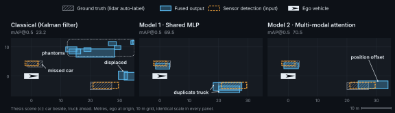
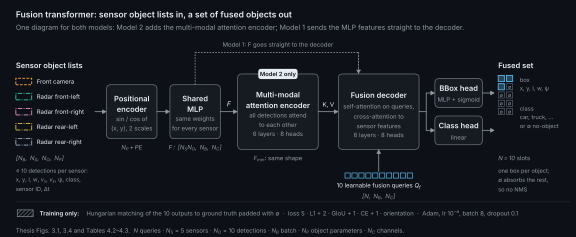
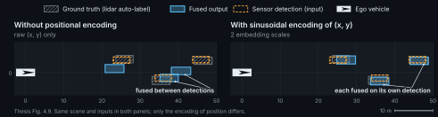

# Transformer-Based Camera–Radar Object Fusion for Automated Driving

> **Master's thesis · TU Dortmund, Institute of Control Theory and Systems Engineering · Dec 2023**
> A DETR-style transformer that takes the object lists from **1 front camera + 4 corner radars** and outputs one fused set of objects. It is trained end-to-end against lidar ground truth and needs no hand-tuned association, gating or NMS.

<p align="center">
  
  <br><sub>One real highway frame (car beside the ego vehicle, truck ahead), bird's-eye view.<br>The classical baseline produces phantom, displaced and missed objects; both transformers recover the car and the truck.</sub>
</p>

<p align="center">
  
  
  
</p>

---

## TL;DR

| | |
|---|---|
| **Problem** | Combine *object-level* detections from several sensors of different types into one consistent list of objects. Classical Kalman-filter fusion needs precise sensor models, and it struggles when sensor quality changes with position, speed and weather. |
| **Approach** | Treat fusion as **set prediction**. Every sensor detection becomes a token, and learned *fusion queries* attend to them. Hungarian matching against lidar ground truth makes training end-to-end. |
| **Result** | **~3× the classical baseline:** mAP@0.5 of **70.5 vs 23.2**, and mAP@0.7 of **60.1 vs 17.9**. Trucks went from **3.7 → 79.3 AP**. |
| **Data** | 175 real highway scenes of 15 min each from the KISSaF project (**677k frames**), with lidar ground truth produced by an auto-labelling tool. |

## Results

Evaluated on about 4,000 held-out highway frames. All values are 11-point interpolated AP; full-interpolation numbers are in the thesis.

| Class | | AP@0.5 | | | AP@0.7 | |
|---|---|---|---|---|---|---|
| | Classical (Kalman filter) | Shared-MLP | **Multi-modal attention** | Classical | Shared-MLP | **Multi-modal attention** |
| Car | 42.7 | 61.5 | **61.7** | 35.7 | 59.7 | **60.0** |
| Truck | 3.7 | 77.4 | **79.3** | 0.1 | 58.2 | **60.3** |
| **mAP** | 23.2 | 69.5 | **70.5** | 17.9 | 59.0 | **60.1** |

**Localisation error** (80th percentile, best model): **1.07 m** in x, **< 0.7 m** in y, **0.55 m** in length, **0.12 m** in width.

**Qualitatively**, the classical pipeline often produces duplicate or displaced objects, especially for trucks. That happens when one radar sees a truck as two clusters while the camera sees one object. The transformer learns to merge them into a single object.

## Architecture

<p align="center">
  
</p>

I compared two variants:
1. **Shared-MLP encoder:** every detection is embedded on its own, and the decoder does all of the fusion.
2. **Multi-modal attention encoder:** a transformer encoder lets detections from *different sensors* attend to each other before decoding. This gave the best results, with the largest gains on trucks and on box shape.

**Key design decisions**

- **High-level (object-level) fusion.** The model works on sensor object lists, not raw data. That keeps it modular and practical for OEM-style sensor setups, where each sensor ships its own perception stack.
- **Objects as tokens.** Each token carries the object's state, sensor ID and time offset, so attention can learn which sensor to trust in which situation.
- **Sinusoidal position encoding of (x, y).** It separates detections that are very close together. An ablation over embedding scales {0, 2, 4, 6, 8, 10} showed that without it, the model merges nearby objects into one (see figure below).
- **DETR-style set prediction.** A fixed set of queries is matched one-to-one to ground truth with the **Hungarian algorithm**, using a "no-object" class for the extra queries. Duplicates are therefore removed without NMS or existence thresholds.
- **Loss:** weighted cross-entropy to handle class imbalance (lots of cars and no-object slots, few trucks), plus box regression, **GIoU** and a heading loss.
- **Lidar used only as ground truth.** Lidar is left out of the inputs on purpose, so the model learns to fuse camera and radar on their own.

<p align="center">
  
</p>

## Repository layout

```
├── train.py                 # training loop (Hydra + W&B)
├── evaluate.py / metric.py  # AP / mAP at IoU 0.5, 0.7, 0.9
├── model/                   # transformer, encoder/decoder, embeddings, heads
├── loss/                    # Hungarian matcher, set criterion, box utils
├── dataset/                 # sensor-log parsing, sync & preprocessing
├── config/                  # Hydra configs: dataset / model / training / experiment / sweep
└── visualization*.py, plot.py
```

## Code availability

> [!NOTE]
> **This repository is published to show the method and implementation; it cannot be run as-is.** The KISSaF driving recordings and the project-internal log-reading tools (`environment_model`, `SDFReader`) belong to a research project and are not publicly available.

## Future work

The fusion queries already work like object slots. Keeping them consistent from frame to frame, using temporal attention over the previous frame's queries, would extend the model to end-to-end **multi-object tracking**.

## Thesis

**"Deep High-Level Object Fusion and Multi-Object Tracking"**, Master's thesis, Technische Universität Dortmund, December 2023.
<!-- TODO: link the PDF (e.g. docs/thesis.pdf) -->

## Author

**Rajesh Pushparaj**  <!-- TODO: LinkedIn · email · personal site -->
